# 直播模块完整流程图

依据：2026-10-29 工作区现有代码。本文描述已实现行为，不是未来设计；按业务总览、接入、投票、走棋、互动、展示和生命周期分层。

## 1. 整体业务闭环

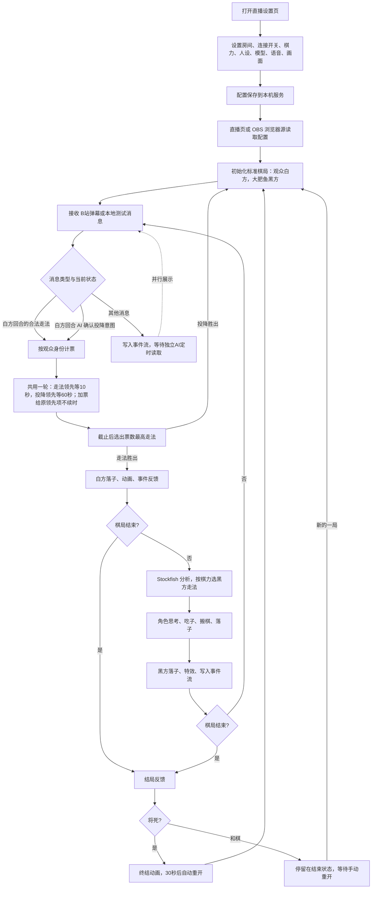

**职责划分：** chess.js 判定合法走法和终局；Stockfish 19 负责黑方决策和分析；DeepSeek 负责自然语言走法识别和基于事件流的定时聊天。关闭 AI 开关后，明确走法投票与黑方引擎走棋仍然可用。页面底部虽然写着“DEEPSEEK PLAYS BLACK”，实际下棋决策由 Stockfish 完成。

## 2. 页面入口、配置同步与运行边界

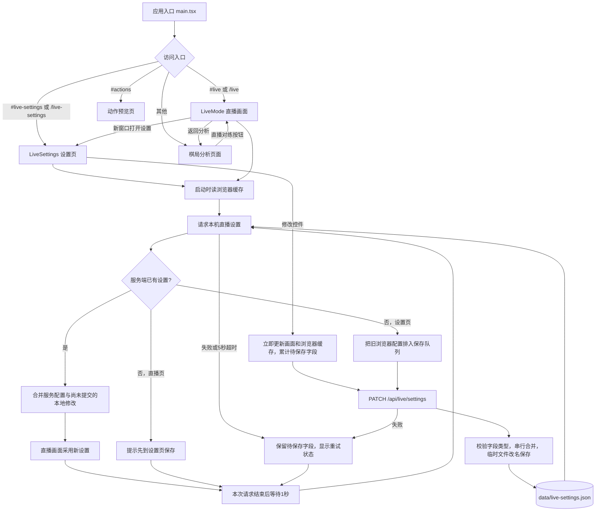

- 设置页与直播源通过本机服务同步，不要求共享浏览器存储；OBS 新建浏览器源不会用自己的默认值覆盖服务设置。
- 默认值包括：自动连接开启、AI 关闭、深度 2、棋力 100、语音关闭。房间为空时不会连接。
- 直播展示模式、文字比例、棋盘角度影响呈现；投票、决策和对局状态仍由直播页面实例维护。
- **共享的是设置与弹幕服务，不是同一盘棋。** 每个 LiveMode 实例各自创建 Chess、VoteRound 和聊天记忆；同时打开多个直播页会各自运行。
- 配置和服务 API 由 Vite 插件在开发/预览服务中提供；单独复制静态页面不能替代这些服务。

## 3. B站扫码登录

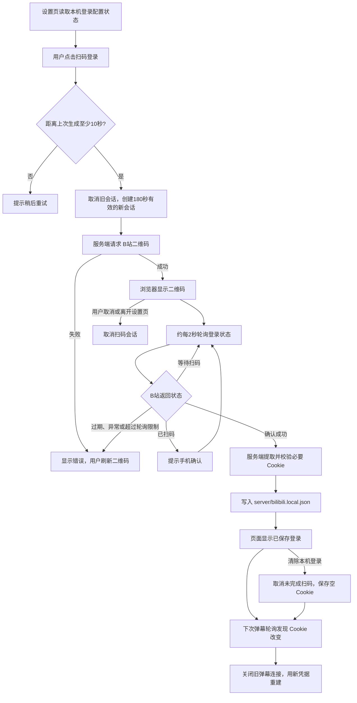

登录凭据保存在本机服务文件，页面得到的是状态和二维码信息。未配置 Cookie 时，弹幕服务仍会尝试匿名连接；能否获得有效观众身份取决于 B站返回数据。界面的“已保存登录”表示本机存在配置，并不等同于实时验证登录仍有效。

## 4. 弹幕连接、重连与去重

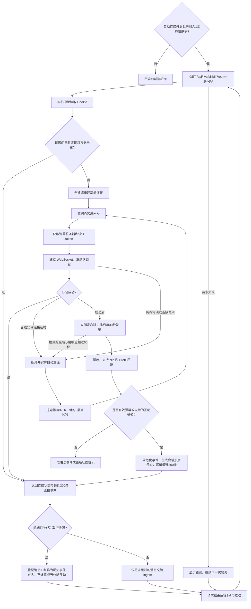

- 前端去重集合超过 1000 条时保留最近 300 个 ID；服务端每条弹幕最多保留 300 字符、昵称最多 40 字符。
- 中继最多保存 8 个房间；满额时淘汰最久未使用的房间。每 15 秒清理一次，超过 60 秒无人读取的房间会断开。
- 用户点击断开后，前端停止读取；服务端房间连接通常由上述空闲清理回收，并非点击即立即关闭。
- 这是“服务端 WebSocket 接收 + 前端 HTTP 轮询快照”，高流量超过缓冲容量时可能漏消息。

## 5. 单条弹幕的分流与 AI 走法识别

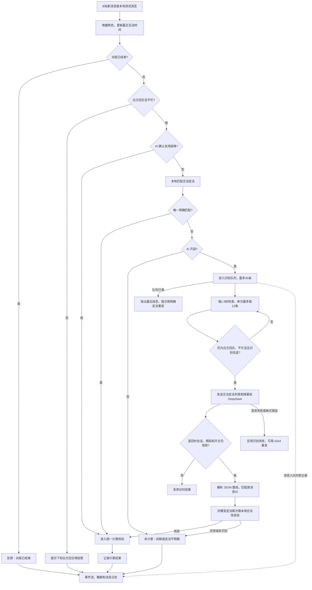

本地支持 `e2e4`（UCI）、`e4` / `Nf3`（SAN）、`e2到e4` / `e2-e4`、`马到f3`，以及前缀“投票”。必须匹配当前合法着法，歧义不会直接计票。升变可用 `e7e8q` 明确指定棋子。

事件流与投票是并行用途：一条消息未计票，不代表它不能进入定时聊天上下文。黑方回合收到的走法不会自动保存到下一轮重新投票。弹幕现场保留最近 80 条，界面展示最近 12 条；飘屏保留至多 14 条、分 4 条轨道，减少动态效果模式下不显示飘屏。

## 6. 投票窗口与白方落子

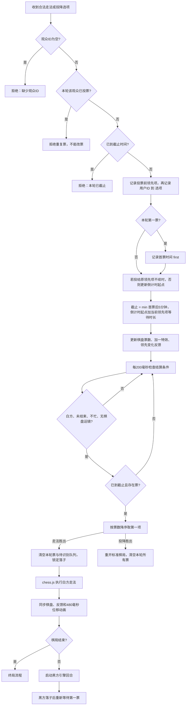

- 没有首票时截止时间为无穷，不会自动替观众走棋。
- 首票启动倒计时。有效新票投给投票前领先选项时不重置；投给其他选项时重置。重复票和无效消息不续时。当前领先项为走法时等待10秒，为投降时等待60秒；领先项变化后按新领先项的时长计算。
- 平票没有随机或加赛逻辑：按稳定排序和 Map 插入顺序，先被投到的走法优先。
- 同一观众每个白方回合只能在普通走法与投降中选一项，共用用户票集合，不能重复投票或改票。投降不绘制棋盘箭头；若投降领先，其他走法不显示领先标记。
- 运镜可能推迟实际落子时刻，但不会延长已确定的投票截止时间。

## 7. 黑方引擎决策与角色动作

魔鱼模式开启时，改用本地游戏 AI，不调用 SF。当前支持普通走棋、破坏与临时皇后／马移动；规则、搜索、回退及历史段边界见 [魔鱼模式](demon-fish.md)。以下流程描述普通走棋分支。

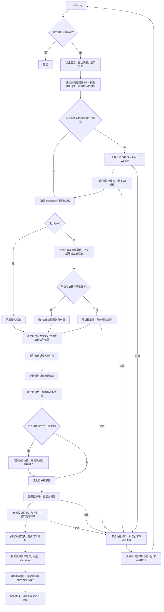

引擎默认搜索参数为单线程、16 MB Hash、最长搜索时间参数 12 秒；直播调用同时指定深度，实际结束受引擎搜索条件影响。Worker 需要跨源隔离及 SharedArrayBuffer，Vite 配置提供 COOP/COEP 响应头。

动作过程会检查会话代数和页面存活状态；重开后旧动画不能继续提交旧局走法。吃过路兵时，目标被吃棋子位置使用原所在行计算。棋子位移动画另处理王车易位的车。

## 8. 独立 AI 聊天与定时事件流

原先的棋后主动点评、弹幕停顿触发AI回复、欢迎与闲置聊天已从直播主流程移除；重开和唤醒可显示本地短句，并记录实际显示的话。棋盘只产出事件，由独立 AIChat 模块定时读取；投票用的自然语言走法识别仍独立保留。

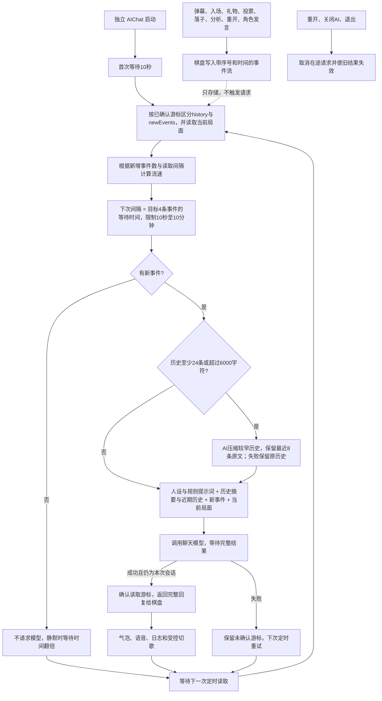

- 初始间隔为10秒；公式为 clamp(10000, 600000, 本次与上次读取相隔毫秒数 × 4 / 新增事件数)。没有新增事件时按上次实际间隔翻倍，直到10分钟。
- 一次最多一个聊天请求在途；完成后距下次读取至少10秒。请求耗时不会导致并发补发。超长请求期间不会强行启动下一次读取。
- 新事件不会主动唤醒模块或提前重排定时器；若当前已退避到10分钟，新消息等待下一个定时点才被读取。
- 事件包括 session、chat、vote、move、analysis、entry、follow、share、gift、guard、superchat、like、speech；每条含 id、at、kind、data。chat 记录原弹幕及处理反馈，vote 记录成功计票及排名，move 记录真实落子及新局面，analysis 记录引擎候选与可能变化。
- 事件流保留最近300条。溢出数量作为 droppedEvents 告知模型；成功后才确认游标，请求期间新来的事件留到下次。失败则下次重读尚未确认的事件。
- 无新事件不请求模型；模型可返回空文本表示没有值得说的话。完整回复再返回棋盘显示和可选播报，不逐字显示中间结果。
- 不再单独请求棋后解说。定时读取时，未压缩历史达到24条或序列化超过6000字符，可用解析模型压缩较早历史（600输出token），保留最近8条原文。摘要逐次合并，目标400字，存储上限1500字符；失败或空摘要保留原历史继续聊天，下个定时点可重试。重开会清空摘要并取消在途压缩。
- 请求字段明确区分 historySummary（更早历史摘要）、history（近期历史，最多40条）、newEvents（本次未处理事件）与 window（成功处理游标至当前读取边界）。压缩只处理历史，绝不把本次新事件提前并入摘要。最近5次AI回复另作去重参考。
- speech 标记 source=local 或 ai；只记录已显示的非空文字。仅有角色发言时推进游标但不请求模型，这些发言留作后续历史，避免AI回应自己。当前本地短句为重开及唤醒提示。旧的点评概率配置不再影响直播。
- 重开清空事件流与回复上下文，记录新局事件，并重新等待10秒；关闭AI或离开页面取消调度和在途聊天请求。

## 9. 落子后事件、运镜与终局

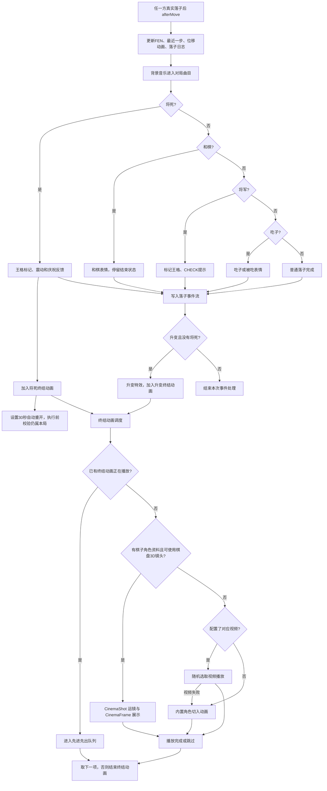

升变并同时将死时只播放将死终结，附带“升变 · 将死”信息。内置切入动画正常为 3.4 秒，减少动态效果模式下为 1.5 秒。视频来自 `public/live-videos/promotion` 与 `public/live-videos/checkmate`，支持 mp4、webm、ogv；未放视频仍可显示内置效果。

**只有棋盘运镜会明确阻塞白方结算和黑方搬棋阶段。** 普通视频/切入层不应理解为全局暂停棋局。减少动态效果模式会跳过或减少部分视觉表现，但仍保留业务流程。

## 10. 语音、音乐与角色闲置行为

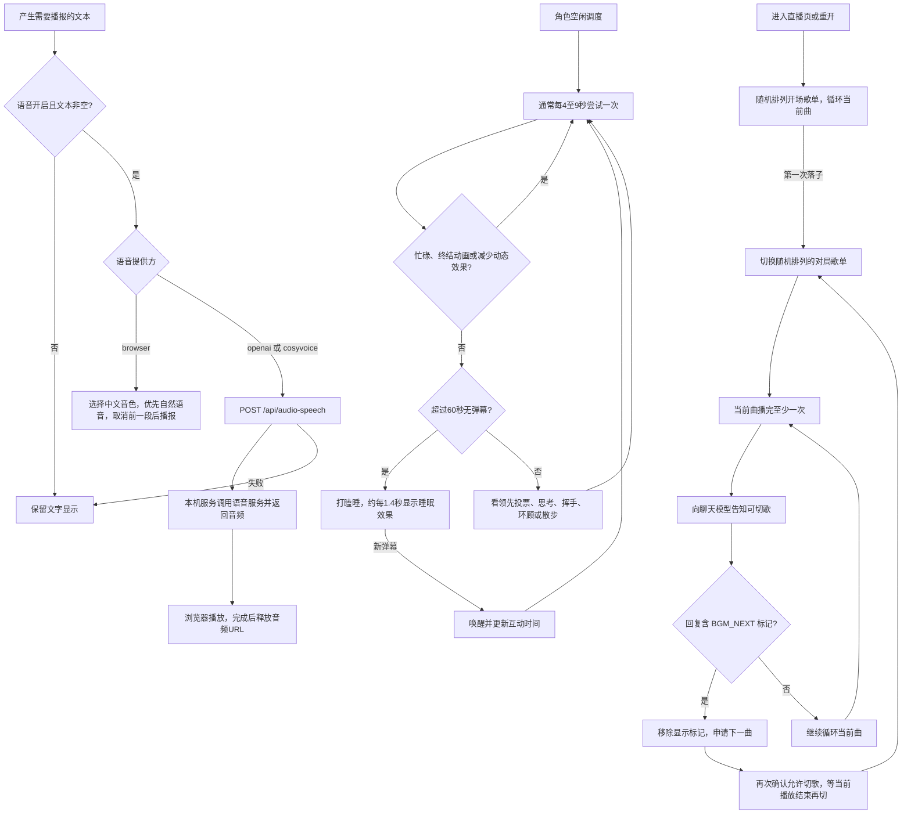

语音失败通常被调用方吞掉，文字交互继续；没有实现远程语音失败后自动切换浏览器语音。BGM 播放失败会被忽略，浏览器自动播放限制可能导致开场没有声音。切歌请求必须经过播放器自身校验，模型输出标记不能绕过“已完整播放一次”的限制。

## 11. 投降、重开、退出与异常恢复

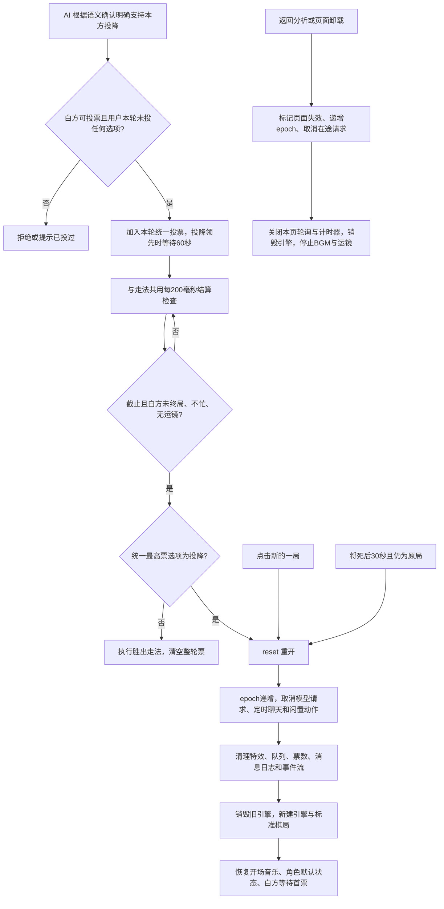

现有实现的边界：

1. 投降与所有走法共同排名，共用一人一票与截止检查；平票时投降始终排在所有走法之后，走法之间按首次获票顺序。每次本轮结算清空所有票，不跨白方回合保留投降票。
2. 投降同样只在白方可投票时接收，并在白方空闲且没有棋盘运镜时结算。投降胜出通过 reset 重开，旧局异步工作通过 epoch 和取消请求失效。
3. 将死的双方都设置 30 秒重开；和棋分支没有自动重开定时器。
4. 重开清空事件流和独立AI最近回复上下文，新会话延迟10秒首次读取。
5. 重开保留设置与弹幕连接，不重新扫描历史弹幕。刷新页面则新建本页棋局，没有恢复上一盘完整状态的流程。
6. AI关闭会清空识别队列并屏蔽旧识别结果，同时停止定时聊天并中止在途聊天请求。
7. 退出和重开没有统一取消远程 TTS 音频播放的流程，不能把“取消所有异步工作”理解成已经覆盖全部音频。
8. 引擎或动画异常会显示错误并解除忙碌；黑方回合可手动重试，不会自动改为观众替黑方走棋。

## 12. 接口、状态与代码定位

| 接口 | 用途 | 主要调用位置 |
|---|---|---|
| GET /api/live/settings | 读取共享直播设置 | liveConfig.ts |
| PATCH /api/live/settings | 合并保存设置 | liveConfig.ts |
| GET /api/live/login | 查询本机是否保存登录配置 | BilibiliLogin.tsx |
| POST /api/live/login/qr | 创建扫码会话 | BilibiliLogin.tsx |
| POST /api/live/login/poll?id=… | 检查扫码状态 | BilibiliLogin.tsx |
| POST /api/live/login/cancel?id=… | 取消扫码会话 | BilibiliLogin.tsx |
| POST /api/live/login/logout | 清除本机登录 | BilibiliLogin.tsx |
| GET /api/live/bilibili?room=… | 获取弹幕快照与连接状态 | LiveMode.tsx |
| GET /api/live/videos | 获取升变、将死视频清单 | LiveMode.tsx |
| POST /api/live/log | 追加直播日志至 data/live.log | log.ts |
| POST /api/model-chat | 走法识别、定时聊天、历史压缩 | core.ts |
| POST /api/audio-speech | 远程语音合成 | voice.ts |

| 状态/对象 | 含义 |
|---|---|
| game / fen | 本页真实棋局与用于渲染的局面 |
| round | 当前白方回合的走法与投降用户票、首票时间、末票时间和倒计时起点 |
| busy | 正在结算、思考或执行落子动作 |
| queue / parseBusy | 待识别弹幕与识别请求是否在途 |
| events / aiChat | 棋盘事件流与独立定时聊天消费者 |
| AIChat generation / cursor | 聊天会话版本及已成功处理的事件游标 |
| epoch / alive | 当前棋局会话版本与页面是否存活 |
| ultimate / ultimateQueue | 当前终结效果与后续排队效果 |
| settings | 本机共享设置在当前页面的副本 |

主要代码入口（相对于项目根目录）：

- `src/main.tsx`：入口路由。
- `src/live/LiveMode.tsx`：消息分流、主循环、走棋、事件汇集、聊天结果展示、动作、重开。
- `src/live/core.ts`：VoteRound、resolveMove、模型请求封装。
- `src/live/liveConfig.ts`、`src/live/LiveSettings.tsx`：配置同步与设置页面。
- `scripts/live-service.mjs`：直播 API、本机配置和日志。
- `scripts/bilibili-live.mjs`、`scripts/bilibili-login.mjs`：实时弹幕中继和扫码状态机。
- `src/core/engine.ts`、`src/live/difficulty.ts`：Stockfish 搜索、缓存与棋力选招。
- `src/live/eventStream.ts`、`src/live/aiChat.ts`、`src/live/speech.ts`：事件存储、独立定时聊天与气泡展示。
- `src/live/ThreeBoard.tsx`、`src/live/cinemaShot.ts`、`src/live/Ultimate.tsx`：棋盘、运镜与终结展示。
- `src/live/voice.ts`、`src/live/music.ts`：语音和音乐。
- `scripts/model-service.mjs`：模型和语音服务转发。

验证范围：基于源代码静态梳理，并参考现有直播、设置同步、扫码和中继测试用例；已同步统一投票与定时聊天改造；单元测试和模拟模型的浏览器测试验证行为，未执行真实 B站登录或付费模型调用。

### 直播互动协议与历史边界

服务端 roomEvents 是统一事件队列，messages 保留仅弹幕的兼容视图；前端优先使用 roomEvents，按同一消息ID去重。支持 INTERACT_WORD / INTERACT_WORD_V2 的入场、关注、分享，SEND_GIFT / SEND_GIFT_V2（含批次内每个礼物）、GUARD_BUY、SUPER_CHAT_MESSAGE 与 LIKE_INFO_V3_CLICK。COMBO_SEND 累计通知不重复算作新礼物；陌生或畸形通知忽略，不影响弹幕连接。礼物与醒目留言不会进入走法识别或计票。

初次连接获取的缓存标为 historical，仅作为历史上下文；新快照中首次出现的ID才进入 newEvents。正常事件在聊天成功后从新增区转为历史；失败保留新增区等待定时重试。历史与新增各保留原事件时间、类型和序号，角色本地短句和AI回复标注来源。缓冲区共保留最近300条，历史发送窗口最多40条，超出缓冲的未读数量以 droppedEvents 报告。

协议字段参照项目维护者的 [blivedm 消息模型](https://raw.githubusercontent.com/xfgryujk/blivedm/dev/blivedm/models/web.py) 和 [V2 protobuf 字段定义](https://raw.githubusercontent.com/xfgryujk/blivedm/dev/blivedm/models/pb.py)。此处验证采用模拟通知，不代表真实房间一定推送每类事件。
